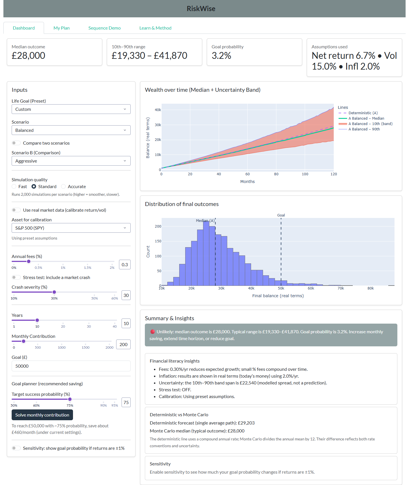
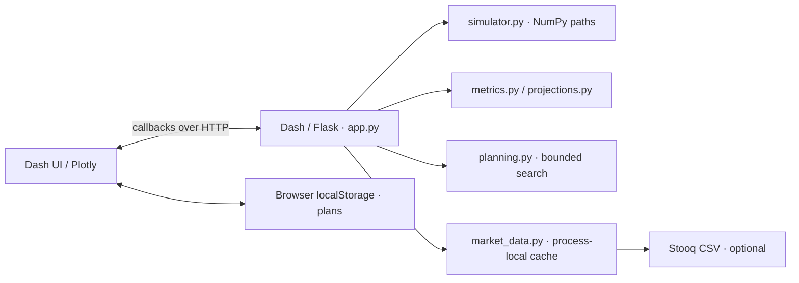

# RiskWise

Monte Carlo investment simulator built with **Python, NumPy, Dash and Plotly** for Hackonomics 2026. Explore how contributions, volatility, fees and inflation affect a distribution of investment outcomes.

**[Live demo](https://riskwise-v04j.onrender.com/)** — checked 3 November 2026: dashboard and charts rendered successfully. Render may show a wake-up page on first visit.

## Features

- 1,000 / 2,000 / 5,000 simulated paths; P10 / median / P90 and goal probability.
- Scenario comparison, illustrative crash stress, fee drag and return sensitivity.
- Bounded monthly-saving solver, sequence-of-returns demo, browser-local plan snapshots and JSON export.
- Optional SPY / QQQ / IWM historical calibration from Stooq, with preset fallback.

<details>
<summary>Application screenshot — local build, genuine default scenario</summary>



[Sequence-of-returns demo screenshot](docs/screenshots/sequence-demo.png)

</details>

## Architecture



One WSGI application served by Gunicorn; no separate REST API, database or account system.

## Run and test

Requires **Python 3.12**. From a clone of this repository:

```bash
python -m venv .venv
# Activate: Windows PowerShell .\.venv\Scripts\Activate.ps1
# macOS/Linux: source .venv/bin/activate
python -m pip install -r requirements.txt
python SRC/app.py
```

Open `http://127.0.0.1:8050`. Tests use standard-library unittest:

```bash
# PowerShell: $env:PYTHONPATH="SRC"
# macOS/Linux: export PYTHONPATH=SRC
python -m unittest discover -s tests -v
```

The [CI workflow](.github/workflows/ci.yml) runs tests, dependency checks and a Linux Gunicorn smoke test once pushed. [Setup and deployment details](docs/DEVELOPMENT.md).

## Model and limitations

Independent normal monthly **simple returns**, fixed nominal contributions after growth, and 2% annual inflation. Percentiles describe simulated outcomes, not confidence intervals or guarantees. Historical log-return calibration is an approximation; Stooq returned HTTP 404 at the final check, so presets were used. Crash stress also scales later contributions. No taxes, asset correlations or fat-tail model. Educational use only.

[Exact methodology](docs/METHODOLOGY.md) · [Audit and validation](docs/AUDIT.md)
